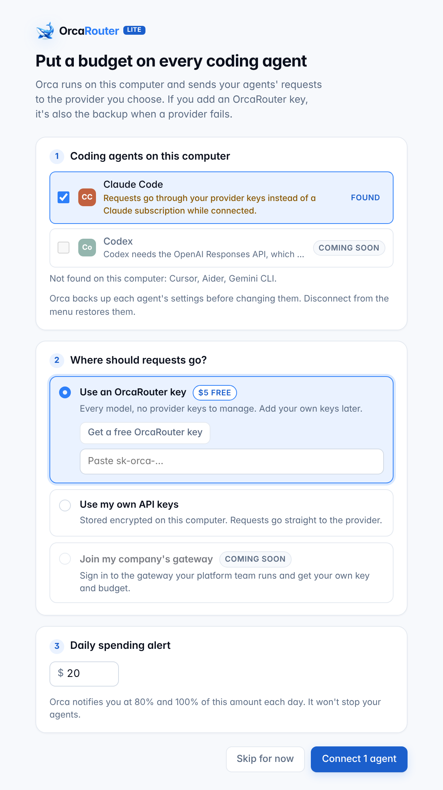

# OrcaRouter Lite

**모든 코딩 에이전트에 예산을 설정하세요.**
Claude Code, Codex, Gemini CLI, OpenCode, 그리고 직접 만든 앱이 모든 모델 공급자에서 쓰는 비용을 확인하고
상한을 정할 수 있습니다. 프롬프트는 내 컴퓨터 밖으로 나가지 않습니다. 개발자 한 명에게는 메뉴 바 앱으로,
팀 전체에는 자체 호스팅 라우터로 쓸 수 있습니다. MIT 라이센스입니다.

[](https://github.com/Continuum-AI-Corp/OrcaRouter-Lite/actions/workflows/ci.yml)
[](https://github.com/Continuum-AI-Corp/OrcaRouter-Lite/actions/workflows/desktop.yml)
[](#license)

<p>
  
  
</p>

## 언어

- [영어](./README.md)
- [일본어](./README.ja.md)
- [중국어](./README.zh.md)
- [한국어](./README.ko.md)
- [독일어](./README.de.md)
- [프랑스어](./README.fr.md)
- [스페인어](./README.es.md)
- [이탈리아어](./README.it.md)
- [Русский](./README.ru.md)
- [포르투갈어](./README.pt.md)
- [Tiếng Việt](./README.vi.md)
- [힌디어](./README.hi.md)

**관련 제품:** [전체 모델 API](https://www.orcarouter.ai/models) · [OrcaCode Review](https://www.orcarouter.ai/code-review) · [OrcaReplay](https://github.com/Continuum-AI-Corp/OrcaReplay) · [OrcaPromptVault](https://github.com/Continuum-AI-Corp/OrcaPromptVault)

OrcaRouter Lite는 [OrcaRouter](https://www.orcarouter.ai)의 오픈 소스 버전입니다. 내 컴퓨터나 서버에서 실행되고, OpenAI·Anthropic·Gemini API를 지원하며, 장애 상황이나 키가 없는 모델을 위한 안전망으로 호스팅된 `api.orcarouter.ai`를 사용할 수 있습니다.

## 데스크톱 앱

Orca 앱은 메뉴 바에 상주합니다. `127.0.0.1`에서 라우터를 실행하고, 코딩 에이전트를 라우터에
연결하고, 에이전트들이 쓰는 비용을 보여 줍니다.

- **오늘의 지출, 에이전트별로.** 오늘 총액은 시계 옆에 표시되고, 패널에서 에이전트별로 나눠 볼 수 있습니다. 매주 월요일에는 한 주를 요약한 알림이 옵니다.
- **일일 예산.** 설정한 금액의 80%와 100%에 도달하면 알림을 보냅니다. 기본값은 알림만 보내는 것이며, 체크박스 하나를 켜면 한도에 도달했을 때 Orca가 코딩 에이전트를 일시 중지합니다.
- **원클릭 연결.** Orca가 에이전트 자체의 설정을 수정하고, 백업을 보관했다가, 연결을 해제하면 원래대로 복원합니다.
- **멈추지 않음.** 공급자에 장애가 나거나 속도 제한에 걸리면 요청이 다른 공급자나 호스팅된 OrcaRouter로 대체되며, 앱은 이렇게 살려 낸 요청 수를 집계합니다. 계정은 `orca link --key sk-orca-…` 또는 설정 화면에서 연결합니다.
- **기본적으로 비공개.** 프롬프트는 에이전트에서 선택한 공급자로 바로 전송됩니다. 텔레메트리는 없습니다.
- **팀 게이트웨이와 함께 사용.** `orca login https://ai-gw.example.com --key …`(또는 초기 설정의 "Join my company's gateway")로 플랫폼 팀이 운영하는 게이트웨이에 에이전트를 연결하고, `orca logout`으로 원래대로 복원합니다.

**설치.** 설치 파일(`.dmg`, `.deb`, `.AppImage`, `.msi`)은
[`desktop.yml`](./.github/workflows/desktop.yml)로 빌드되며, 다음 태그 버전부터 각 릴리스에
첨부됩니다. 그때까지는 같은 엔진과 CLI를 명령 한 줄로 사용할 수 있습니다.

```bash
uvx --from git+https://github.com/Continuum-AI-Corp/OrcaRouter-Lite orca up
```

```bash
uvx --from git+https://github.com/Continuum-AI-Corp/OrcaRouter-Lite orca connect claude-code
```

```bash
uvx --from git+https://github.com/Continuum-AI-Corp/OrcaRouter-Lite orca status
```

`orca up`은 `http://127.0.0.1:8765/desktop/panel.html`에서 패널을 제공합니다. 메뉴 바 앱 자체를
빌드하려면 [`desktop/`](./desktop/README.md)을 참조하세요. 첫 릴리스가 나오면 macOS 사용자는
`brew install --cask continuum-ai-corp/tap/orcarouter-lite`로도 설치할 수 있습니다.

Claude Code 상태 표시줄에 오늘의 지출을 표시하려면 `~/.claude/settings.json`에 다음을 추가하세요.

```json
"statusLine": { "type": "command", "command": "orca statusline" }
```

`orca report`는 한 주의 내역을 Markdown(또는 `--format csv`)으로 출력하므로 채팅이나 스프레드시트에 바로 붙여 넣을 수 있습니다.

| 에이전트 | 연결 방식 |
|---|---|
| Claude Code | 자동: `~/.claude/settings.json`에 `ANTHROPIC_BASE_URL`과 전용 키를 설정 |
| Codex | 자동: `~/.codex/config.toml`에 `orca` 공급자(Responses API)를 추가하고 `model = "auto"`로 선택 |
| Gemini CLI | 자동: `~/.gemini/.env`에 `GOOGLE_GEMINI_BASE_URL`과 전용 키를, `~/.gemini/settings.json`에 Gemini CLI의 게이트웨이 로그인을 설정 |
| OpenCode | 자동: `~/.config/opencode/opencode.json`에 `orca` 공급자를 추가하고 `orca/auto`를 선택. 키는 OpenCode가 읽는 비공개 파일에 보관 |
| Command Code | 자동: `~/.commandcode/providers.json`에 `orca` 공급자를 추가하며 키는 비공개 파일에서 가져옴(Command Code는 이 파일에 키를 직접 넣는 것을 허용하지 않음) |
| Cline | 붙여넣기 한 번: Cline에서 API Provider → OpenAI Compatible을 선택하고 앱이 보여 주는 기본 URL과 키를 붙여넣기 |
| Aider | 자동: `~/.aider.conf.yml`에 `openai-api-base`, 전용 키, `model: openai/auto`를 설정 |
| Cursor | 붙여넣기 한 번: Cursor 모델 설정에 넣을 기본 URL과 키를 앱이 보여 줌 |
| Hermes Agent | 자동: `~/.hermes/config.yaml` (Windows: `%LOCALAPPDATA%\hermes`) → `providers.orca`, `model.provider: custom:orca` |
| Pi | 자동: `~/.pi/agent/models.json` → `providers.orca`; `settings.json` → `defaultProvider: orca`, `defaultModel: auto` |
| OMP | 자동: `~/.omp/agent/models.yml` → `providers.orca`; `config.yml` → `modelRoles.default: orca/auto` |
| Kilo Code | 자동: `~/.config/kilo/kilo.json` → `provider.orca`, `model: orca/auto` (`{file:…}` key) |
| OpenClaw | 자동: `~/.openclaw/openclaw.json` → `models.providers.orca`, `agents.defaults.model.primary: orca/auto` |
| Kimi Code | 자동: `~/.kimi-code/config.toml` → `[providers.orca]`, `[models.orca-auto]`, `default_model` |
| Goose | 자동: `~/.config/goose/custom_providers/orca.json` (`auth.command` key) + `config.yaml` → `GOOSE_PROVIDER: orca` |
| Zed | 붙여넣기 한 번: `settings.json` → `language_models.openai_compatible.Orca` (`api_url`, model `auto`) + key in Zed / `ORCA_API_KEY` |
| OpenHands | 붙여넣기 한 번: `/settings` → Advanced: model `openai/auto`, base URL, key |
| DeepSeek Harness | 붙여넣기 한 번: Settings → Models → custom OpenAI-compatible provider, model `auto` |
| ZCode | 붙여넣기 한 번: Add provider → Create custom provider → OpenAI chat completions, model `auto` |

연결된 에이전트마다 전용 키가 발급됩니다. 이 덕분에 에이전트별로 지출을 나눌 수 있고, 연결을 해제하면
즉시 접근이 취소됩니다. 앱이 컴퓨터에서 건드릴 수 있는 범위는
[SECURITY.md](./SECURITY.md#what-the-desktop-app-and-orca-cli-can-touch)에 명시되어 있습니다.

<a id="free-and-open-for-good"></a>
## 영원히 무료, 영원히 오픈

- **영구적인 MIT.** 개발자 한 명이나 팀 하나에 필요한 모든 것은 MIT 라이센스로 이 저장소에 남습니다: 라우팅, `model="auto"`, 예산, 대시보드, 데스크톱 앱. Lite의 기능을 유료 플랜으로 옮기는 일은 없습니다.
- **유료는 조직을 위한 것입니다.** 여러 팀을 관리하는 기능(SSO/SCIM, 역할 기반 접근 제어, 조직 전체 예산과 정책, 감사 로그 보존, Slack 및 이메일 알림)은 [호스팅 OrcaRouter](https://www.orcarouter.ai)에서 제공합니다.
- **검증 가능.** 릴리스는 서명되며 출처 증명(provenance)과 SBOM이 함께 제공됩니다. [SECURITY.md](./SECURITY.md)를 참조하세요.

## 비교

| | 적합한 대상 | 실행 방식 |
|---|---|---|
| **OrcaRouter Lite** | 새 인프라 없이 에이전트별 지출, 예산, 장애 조치를 원하는 개인 개발자부터 팀까지 | 데스크톱 앱, `uvx`/`pip` 또는 Docker. 기본은 SQLite |
| LiteLLM proxy | 방대한 설정 옵션과 Python SDK를 원하는 팀 | 자체 호스팅 서버. 지출 추적에 Postgres 사용 |
| OpenRouter | API 키 하나로 여러 모델 사용, 청구는 OpenRouter가 담당 | 호스팅 전용. 프롬프트가 OpenRouter 서비스를 거침 |
| Claude Code 자체 게이트웨이 지원 | Claude만 사용하는 회사 | 직접 운영하는 게이트웨이로 Claude Code를 연결. Claude 모델만 |

## 서버로 실행하기(60초)

OrcaRouter를 사용하는 두 가지 방법:

### 경로 A — 자체 호스팅(BYOK)

자신의 컴퓨터에서 Lite를 실행하세요. 자신의 공급자 키를 가져오세요.

```bash
git clone https://github.com/Continuum-AI-Corp/OrcaRouter-Lite.git
cd OrcaRouter-Lite
cp .env.example .env
# add at least one: OPENAI_API_KEY=sk-...  (or ORCAROUTER_API_KEY=...)

docker compose up
# logs: ✓ orcarouter-lite ready. API key: sk-orca-abc123...
```

기본 URL: `http://localhost:8000/v1`. 시작 시 인쇄된 `sk-orca-*` 키를 사용하세요.

### 경로 B — 호스팅(계정 필요)

클론도 없고 도커도 없습니다. 등록하고, 키를 받고, 호스팅된 OpenAI SDK를 지정하세요.

```bash
# 1. Register at https://www.orcarouter.ai and copy your sk-orca-* key
# 2. Use https://api.orcarouter.ai/v1 as the base URL
```

**계정이 필요합니다.** Hosted는 라우팅, 청구 및 공급자의 롱테일을 처리하며 OrcaRouter 계정에서 토큰별로 청구됩니다. [docs.orcarouter.ai/introduction](https://docs.orcarouter.ai/introduction)을 참조하세요.

### 그런 다음 OpenAI SDK에서 호출하세요.

아래 예에서는 경로 A의 로컬 호스트 기본 URL을 사용합니다. 경로 B에 있는 경우 `https://api.orcarouter.ai/v1`로 바꿉니다.

<details>
<summary><b>파이썬</b></summary>

```python
from openai import OpenAI

client = OpenAI(
    base_url="http://localhost:8000/v1",
    api_key="sk-orca-abc123...",
)
r = client.chat.completions.create(
    model="auto",  # or "gpt-4o-mini", "claude-3-5-sonnet-latest", ...
    messages=[{"role": "user", "content": "Hello!"}],
)
print(r.choices[0].message.content)
```
</details>

<details>
<summary><b>Node.js</b></summary>

```js
import OpenAI from "openai";

const client = new OpenAI({
  baseURL: "http://localhost:8000/v1",
  apiKey: "sk-orca-abc123...",
});

const r = await client.chat.completions.create({
  model: "auto",
  messages: [{ role: "user", content: "Hello!" }],
});
console.log(r.choices[0].message.content);
```
</details>

<details>
<summary><b>컬</b></summary>

```bash
curl http://localhost:8000/v1/chat/completions \
  -H "Authorization: Bearer sk-orca-abc123..." \
  -H "Content-Type: application/json" \
  -d '{"model":"auto","messages":[{"role":"user","content":"Hello!"}]}'
```
</details>

대시보드(공급자, 라우팅, 분석, 키)에 대해 `http://localhost:8000/`를 엽니다(경로 A만 해당).

## `model="auto"`

`model="auto"`를 보내면 OrcaRouter는 요청의 기능 요구 사항(도구, 비전, JSON 모드)을 충족하는 구성된 공급자에서 **가장 저렴한** 모델을 선택합니다. 수동 라우팅 규칙이 없습니다. 속도 제한이 없는 체조; 코드에서 `if x: ...` 비용 최적화가 없습니다.

```python
client.chat.completions.create(
    model="auto",
    messages=[{"role": "user", "content": [
        {"type": "text", "text": "What's in this image?"},
        {"type": "image_url", "image_url": {"url": "data:..."}},
    ]}],
)
# → routes to the cheapest VISION-capable model your keys cover
```

해결된 모델은 'x-orca-resolved-model' 응답 헤더를 통해 호출자에게 다시 노출되므로 실제로 사용된 내용을 기록/표시할 수 있습니다.

## 업스트림으로 호스팅됨(Lite + 호스팅됨)

이미 Lite를 실행 중이신가요? [www.orcarouter.ai](https://www.orcarouter.ai)에서 `ORCAROUTER_API_KEY`를 `sk-orca-*`로 설정하면 호스팅된 라우팅 체인에서 로컬 키가 지원하지 않는 모델을 다루는 공급자가 하나 더 추가됩니다.

```bash
# .env
ORCAROUTER_API_KEY=sk-orca-hosted-abc...
```

사용 사례:
- **구매 전 체험** — 로컬 공급자 키가 필요하지 않습니다.
- **로컬 로깅** — 호스팅된 라우팅 처리, Lite는 대시보드에 대한 RequestLog 행 저장
- **장애 조치** — 로컬 공급자가 실패하면 호스팅이 안전망입니다.

## 스트리밍

표준 `data: ... \n\n` 프레이밍 및 터미널 `[DONE]` 센티널을 갖춘 OpenAI 호환 SSE 형식 — 이미 OpenAI에서 스트리밍하는 모든 SDK에 대한 드롭인입니다.

```python
for chunk in client.chat.completions.create(
    model="auto",
    messages=[{"role": "user", "content": "Tell me a story"}],
    stream=True,
):
    print(chunk.choices[0].delta.content or "", end="", flush=True)
```

## 네이티브 프로토콜 엔드포인트(Anthropic + Gemini)

Lite는 하나의 라우팅 파이프라인에 대해 세 가지 수신 프로토콜을 말합니다. Anthropic 또는 Gemini 와이어 형식만 말하는 클라이언트도 직접 연결됩니다. OpenAI SDK가 필요하지 않습니다:

```bash
# Claude Code, pointed at Lite (no /v1 suffix in the base URL)
export ANTHROPIC_BASE_URL=http://localhost:8000
export ANTHROPIC_API_KEY=sk-orca-...
claude
```

```python
# google-genai SDK, pointed at Lite
from google import genai
from google.genai.types import HttpOptions
client = genai.Client(api_key="sk-orca-...",
                      http_options=HttpOptions(base_url="http://localhost:8000"))
client.models.generate_content(model="auto", contents="Hello!")
```

요청은 에지에서 동일한 내부 파이프라인으로 변환되므로 `model="auto"`, 교차 제공자 프롬프트 캐시(프로토콜 간 공유), 라우팅 전략, 분석 대시보드가 모두 동일하게 작동합니다. 가이드: [integrations/claude-code.md](./integrations/claude-code.md), [integrations/gemini-sdk.md](./integrations/gemini-sdk.md)를 참조하세요.

## 모델 카탈로그

시작 시 [LiteLLM의 커뮤니티에서 유지 관리하는 가격 데이터베이스](https://github.com/BerriAI/litellm/blob/main/model_prices_and_context_window.json)에서 100개 이상의 채팅 모델이 로드됩니다. 수동으로 유지 관리할 모델 목록이 없습니다. 각 항목은 다음을 노출합니다.

- `id`(예: `gpt-4o`, `claude-3-5-sonnet-latest`)
- `provider`(구성된 키에 매핑됨)
- 기능 플래그: `supports_tools`, `supports_vision`, `supports_json_mode`
- 토큰당 입/출력 비용(절감 위젯 + `model="auto"` 구동)

`GET /v1/models` returns the OpenAI-format catalogue.

## 다른 곳에 배포

| 플랫폼 | 방법 |
|---|---|
| Docker | `docker run -p 8000:8000 -e OPENAI_API_KEY=... ghcr.io/continuum-ai-corp/orcarouter-lite:<version>` (다음 태그 릴리스부터 게시. [SECURITY.md](./SECURITY.md)의 명령으로 검증 가능) |
| Render | [](https://render.com/deploy?repo=https://github.com/Continuum-AI-Corp/OrcaRouter-Lite): [`render.yaml`](./render.yaml) 사용, 시크릿 생성, 데이터베이스는 디스크에 보관 |
| Fly.io | `fly launch --no-deploy` 후 [`fly.toml`](./fly.toml) 맨 위에 있는 볼륨 및 `fly secrets set` 단계를 거쳐 `fly deploy` |
| Railway | `railway init`, `railway volume add --mount-path /data`, `railway variables --set CREDENTIAL_ENCRYPTION_KEY=$(openssl rand -hex 32) --set API_KEY_PEPPER=$(openssl rand -hex 32) --set DATABASE_URL=sqlite+aiosqlite:////data/orca.db` 후 `railway up`([`railway.json`](./railway.json)으로 빌드) |

## 상자 안에 무엇이 들어있나요?

- `POST /v1/chat/completions` — 프록시 + 스트리밍 + `model="auto"` + 교차 제공자 프롬프트 캐시
- `POST /v1/messages` — **Anthropic Messages API 인그레스**(Claude Code / Anthropic SDK가 직접 연결, `+ /count_tokens`)
- `POST /v1/responses` — **OpenAI Responses API 인그레스**(Codex 및 Responses SDK 클라이언트용, 스트리밍과 함수·사용자 지정 도구 지원)
- `POST /v1beta/models/{model}:generateContent` — **Gemini API 인그레스**(google-genai SDK가 직접 연결, `+ :streamGenerateContent`, `GET /v1beta/models`)
- `GET /v1/models` — 검색 가능한 모델 카탈로그(`litellm.model_cost`의 100개 이상의 모델)
- `GET/PUT/DELETE /v1/providers/{provider}` — 암호화된 공급자 키 설정/목록/해지
- `GET/PUT /v1/routing` — 전략 변경(`균형` / `가장 저렴함` / `가장 빠름` / `품질`)
- `GET /v1/analytics/{recent,spend,latency,savings,unreachable}` — 로컬 분석, 원격 분석 없음
- `GET /v1/hosted` — 호스팅 대체 상태(대시보드의 "5달러 무료 크레딧 받기" 카드 구동)
- `GET/POST/DELETE /v1/keys/...` — API 키 나열 / 회전 / 취소
- `/v1/app/*` — 데스크톱 앱용 에이전트, 지출 요약, 예산(`orca up`으로 시작한 경우에만 제공. [SECURITY.md](./SECURITY.md) 참조)
- `/`의 단일 페이지 대시보드
- 기본적으로 SQLite; Postgres는 `DATABASE_URL`을 통해 선택합니다. Redis 선택 사항

### 교차 제공자 프롬프트 캐시

결정적 요청('온도=0' 또는 고정된 '시드')은 캐시에서 반복적으로 제공됩니다. Anthropic뿐만 아니라 **모든** 제공자에서 작동합니다. 'REDIS_URL'이 설정된 경우 백엔드는 Redis이고, 그렇지 않은 경우에는 in-process LRU입니다. 캐시 적중은 `x-orca-cache: HIT`로 즉시 반환되며 비용은 $0입니다.

```bash
$ curl ... -d '{"model":"auto","messages":[...], "temperature": 0}' -i
HTTP/1.1 200 OK
x-orca-cache: MISS
x-orca-resolved-model: gpt-4o-mini

$ curl ...  # same payload again
HTTP/1.1 200 OK
x-orca-cache: HIT          ← served from cache, no upstream call
```

### 저축 위젯

`GET /v1/analytics/savings?baseline=gpt-4o&days=7` reports what your traffic would have cost on always-GPT-4 vs what it actually cost. The dashboard shows it as a tile.

### 통합

[Claude Code](./integrations/claude-code.md), [Gemini SDK](./integrations/gemini-sdk.md), [Continue.dev](./integrations/continue.json), [Aider](./integrations/aider.md), [Cursor](./integrations/cursor.md), [LangChain](./integrations/langchain_orcarouter.py), [LlamaIndex](./integrations/llamaindex_orcarouter.py), [Vercel AI SDK](./integrations/vercel_ai.ts) 및 OpenAI Chat Completions 프로토콜을 사용하는 모든 도구를 위한 드롭인 구성 — 여기에 네이티브 Anthropic 및 Gemini 와이어 형식도 추가됩니다. [`integrations/`](./integrations/)을 참조하세요.

## 고의로 하지 않은 것

이것은 **단일 작업 공간** 버전입니다. 설계상 다음은 허용되지 않습니다.
- 멀티 테넌시, RBAC, SSO
- 청구, 지갑, 포인트, 파트너 프로그램
- 관리 콘솔, 감사 로그, 신뢰 및 안전
- 다중 포드 배포 / Kubernetes
- 알림을 위한 이메일/Slack/웹후크

이들은 조직용 기능이며 [호스팅 OrcaRouter](https://www.orcarouter.ai)에서 제공합니다. [영원히 무료, 영원히 오픈](#free-and-open-for-good)을 참조하세요.

## 테스트

테스트 우선으로 구축되었습니다. 여기에 제공된 모든 동작에는 먼저 실패한 테스트가 있었습니다.

```bash
pip install -e ".[dev]"
PYTHONPATH=. pytest                          # router, protocols, desktop API, CLI, supply-chain checks
cd desktop && npm test                       # desktop view logic (node --test)
cd desktop/src-tauri && cargo test --lib     # menu-bar title and notification rules
```

## 아키텍처

```
app/
├── main.py             FastAPI factory + lifespan + SPA mount
├── config.py           Settings (~15 fields)
├── deps.py             DI helpers
├── seed.py             First-run bootstrap
├── auto_routing.py     model="auto" capability + cost scoring
├── router_cache.py     Single-workspace router
├── prompt_cache.py     Cross-provider exact-match cache (Redis or in-memory LRU)
├── schemas.py          OpenAI-compatible request schema
├── middleware/auth.py  sk-orca-* validation
└── routes/
    ├── chat.py         /v1/chat/completions  (blocking + streaming)
    ├── models.py       /v1/models
    ├── providers.py    BYOK CRUD
    ├── routing.py      strategy config
    ├── analytics.py    recent / spend / latency / savings / unreachable
    ├── keys.py         list / rotate / revoke API keys
    ├── hosted.py       /v1/hosted — hosted-fallback status for the dashboard
    └── health.py

desktop/
├── ui/                 Menu-bar panel + setup pages (served by the engine at /desktop/)
├── src-tauri/          Native shell: tray title, notifications, starts the engine
└── engine/             PyInstaller build of the bundled `orca-engine`

packages/
├── desktop/            Agent connectors (backup/restore) + desktop home folder
├── litellm_adapter/    Router wrapper + 100+ model catalog
├── auth/               hashing + AES-256-GCM
└── db/                 models + engine + session
```

## 로드맵

- [x] OpenAI 호환 채팅 완료, 스트리밍, `model="auto"`
- [x] Anthropic 및 Gemini 네이티브 엔드포인트
- [x] 업스트림 호스팅 대체, 암호화된 BYOK, 로컬 대시보드
- [x] 공급자 간 프롬프트 캐시
- [x] 데스크톱 앱: 메뉴 바 지출 표시, 일일 예산 알림, 원클릭 에이전트 연결
- [x] 출처 증명과 SBOM이 포함된 서명된 릴리스, 해시로 고정된 의존성
- [x] 알림을 보내거나 한도에서 코딩 에이전트를 일시 중지하는 일일 예산
- [x] `orca login` / "Join my company's gateway": 앱에서 팀의 게이트웨이 사용
- [x] Codex 연결을 위한 `/v1/responses`, 그리고 Gemini CLI, OpenCode, Command Code, Cline 연결
- [x] OS 키체인에 저장되는 암호화 키, 하루 한 번의 업데이트 확인
- [ ] 공유 팀 게이트웨이에서 강제되는 개발자별 예산
- [ ] 임베딩, Ollama/vLLM 공급자, 사용자 지정 대체 체인

장애 조치 데모는 [DEMO.md](./DEMO.md)를 참조하세요.

<a id="license"></a>
## 라이센스

MIT. [라이센스](./LICENSE)를 참조하세요.
