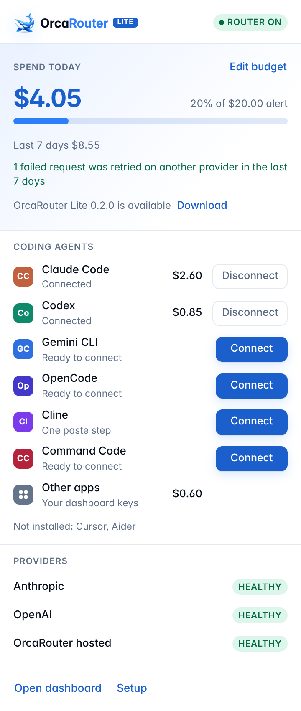

# OrcaRouter Lite

**为每个编程 Agent 设定预算。**
查看并限制 Claude Code、Aider、Cursor 以及你自己的应用在所有模型 provider 上的花费，
提示词不会离开你的机器。对个人开发者，它是一个菜单栏应用；对整个团队，
它是一个自托管路由器。MIT 许可。

[](https://github.com/Continuum-AI-Corp/OrcaRouter-Lite/actions/workflows/ci.yml)
[](https://github.com/Continuum-AI-Corp/OrcaRouter-Lite/actions/workflows/desktop.yml)
[](#license)

<p>
  
  
</p>

## 语言

- [English](./README.md)
- [日本語](./README.ja.md)
- [中文](./README.zh.md)
- [한국어](./README.ko.md)
- [Deutsch](./README.de.md)
- [Français](./README.fr.md)
- [Español](./README.es.md)
- [Italiano](./README.it.md)
- [Русский](./README.ru.md)
- [Português](./README.pt.md)
- [Tiếng Việt](./README.vi.md)
- [हिन्दी](./README.hi.md)

**更多产品：**[全部模型 API](https://www.orcarouter.ai/models) · [OrcaCode Review](https://www.orcarouter.ai/code-review) · [OrcaReplay](https://github.com/Continuum-AI-Corp/OrcaReplay) · [OrcaPromptVault](https://github.com/Continuum-AI-Corp/OrcaPromptVault)

OrcaRouter Lite 是 [OrcaRouter](https://www.orcarouter.ai) 的开源版本。它运行在你的电脑或服务器上，支持 OpenAI、Anthropic 和 Gemini API，并且可以把托管的 `api.orcarouter.ai` 作为安全网，用来应对故障，以及调用你没有密钥的模型。

## 桌面应用

Orca 应用常驻在菜单栏。它在 `127.0.0.1` 上运行路由器，把你的编程 Agent 接入其中，
并显示它们的花费。

- **今日花费，按 Agent 拆分。** 今日总额显示在时钟旁边；面板按 Agent 拆分明细。
- **每日预算。** 达到你设定金额的 80% 和 100% 时发出通知。Agent 照常工作；Orca 只提醒，不拦截。
- **一键连接。** Orca 修改 Agent 自身的设置，保留一份备份，并在你断开连接时恢复原样。
- **永不掉线。** 当某个 provider 故障或对你限流时，请求会回退到另一个 provider 或托管的 OrcaRouter，应用会统计它挽救了多少请求。
- **默认私密。** 提示词从你的 Agent 直接发送到你选择的 provider。没有遥测。

**安装。** 安装包（`.dmg`、`.deb`、`.AppImage`、`.msi`）由
[`desktop.yml`](./.github/workflows/desktop.yml) 构建，并从下一个打标签的版本开始附加到每个 release。
在那之前，同样的引擎和 CLI 只需一条命令即可使用：

```bash
uvx --from git+https://github.com/Continuum-AI-Corp/OrcaRouter-Lite orca up
```

```bash
uvx --from git+https://github.com/Continuum-AI-Corp/OrcaRouter-Lite orca connect claude-code
```

```bash
uvx --from git+https://github.com/Continuum-AI-Corp/OrcaRouter-Lite orca status
```

`orca up` 会在 `http://127.0.0.1:8765/desktop/panel.html` 提供面板；如需构建
菜单栏应用本身，请见 [`desktop/`](./desktop/README.md)。

| Agent | 连接方式 |
|---|---|
| Claude Code | 自动：在 `~/.claude/settings.json` 中设置 `ANTHROPIC_BASE_URL` 和专用密钥 |
| Aider | 自动：在 `~/.aider.conf.yml` 中设置 `openai-api-base`、专用密钥和 `model: openai/auto` |
| Cursor | 粘贴一步：应用会显示用于 Cursor 模型设置的 base URL 和密钥 |
| Codex | 即将支持：需要 OpenAI Responses API（`/v1/responses`），Lite 目前尚未提供 |
| Gemini CLI | 即将支持 |

每个已连接的 Agent 都有自己的密钥：花费正是借此按 Agent 拆分，断开连接也因此能立即撤销访问。
应用可以触碰你电脑上的哪些内容，详见
[SECURITY.md](./SECURITY.md#what-the-desktop-app-and-orca-cli-can-touch)。

<a id="free-and-open-for-good"></a>
## 永久免费、开放

- **永久 MIT。** 一位开发者或一个团队所需的一切，都以 MIT 许可留在这个仓库里：路由、`model="auto"`、预算、仪表板、桌面应用。我们不会把任何功能从 Lite 挪到付费方案。
- **付费面向组织。** 管理多个团队（SSO/SCIM、基于角色的访问控制、全组织范围的预算与策略、审计留存、发往 Slack 和邮件的告警）由[托管版 OrcaRouter](https://www.orcarouter.ai) 提供。
- **可验证。** 每个 release 都经过签名，并附带来源证明（provenance）和 SBOM。详见 [SECURITY.md](./SECURITY.md)。

## 对比

| | 最适合 | 运行方式 |
|---|---|---|
| **OrcaRouter Lite** | 从个人开发者到团队，想要按 Agent 统计花费、设置预算和故障转移，又不想新增基础设施 | 桌面应用、`uvx`/`pip` 或 Docker；默认 SQLite |
| LiteLLM proxy | 需要大量配置项和 Python SDK 的团队 | 自托管服务器；花费追踪需要 Postgres |
| OpenRouter | 一个 API 密钥使用多种模型，由他们计费 | 仅托管；提示词会经过他们的服务 |
| Claude Code 自带的网关支持 | 只使用 Claude 的公司 | 把 Claude Code 指向你自己运行的网关；仅限 Claude 模型 |

## 作为服务器运行（60 秒）

使用 OrcaRouter 的两种方式：

### 路径 A —— 自托管 (BYOK)

在你自己的机器上运行 Lite；自带 provider 密钥。

```bash
git clone https://github.com/Continuum-AI-Corp/OrcaRouter-Lite.git
cd OrcaRouter-Lite
cp .env.example .env
# 至少添加一个: OPENAI_API_KEY=sk-...  (或 ORCAROUTER_API_KEY=...)

docker compose up
# logs: ✓ orcarouter-lite ready. API key: sk-orca-abc123...
```

Base URL：`http://localhost:8000/v1`。使用启动时打印出来的 `sk-orca-*` 密钥。

### 路径 B —— 托管（需要账号）

无需 clone，无需 docker。注册、获取密钥，将任意 OpenAI SDK 指向托管服务。

```bash
# 1. 在 https://www.orcarouter.ai 注册并复制你的 sk-orca-* 密钥
# 2. 使用 https://api.orcarouter.ai/v1 作为 base URL
```

**需要账号。** 托管服务负责路由、计费以及 provider 长尾——按 token 在你的 OrcaRouter 账户上计费。详见 [docs.orcarouter.ai/introduction](https://docs.orcarouter.ai/introduction)。

### 然后从任意 OpenAI SDK 调用

下面的示例使用路径 A 的 localhost base URL —— 如果你在路径 B，请替换为 `https://api.orcarouter.ai/v1`。

<details>
<summary><b>Python</b></summary>

```python
from openai import OpenAI

client = OpenAI(
    base_url="http://localhost:8000/v1",
    api_key="sk-orca-abc123...",
)
r = client.chat.completions.create(
    model="auto",  # 或 "gpt-4o-mini", "claude-3-5-sonnet-latest", ...
    messages=[{"role": "user", "content": "Hello!"}],
)
print(r.choices[0].message.content)
```
</details>

<details>
<summary><b>Node.js</b></summary>

```js
import OpenAI from "openai";

const client = new OpenAI({
  baseURL: "http://localhost:8000/v1",
  apiKey: "sk-orca-abc123...",
});

const r = await client.chat.completions.create({
  model: "auto",
  messages: [{ role: "user", content: "Hello!" }],
});
console.log(r.choices[0].message.content);
```
</details>

<details>
<summary><b>curl</b></summary>

```bash
curl http://localhost:8000/v1/chat/completions \
  -H "Authorization: Bearer sk-orca-abc123..." \
  -H "Content-Type: application/json" \
  -d '{"model":"auto","messages":[{"role":"user","content":"Hello!"}]}'
```
</details>

打开 `http://localhost:8000/` 进入仪表板 —— providers、路由、分析、密钥（仅路径 A）。

## `model="auto"`

发送 `model="auto"`，OrcaRouter 会在你已配置的 providers 中挑选**最便宜**且能满足请求能力要求（tools、vision、JSON 模式）的模型。无需手写路由规则；无需折腾速率限制；代码里也无需 `if x: ...` 的成本优化。

```python
client.chat.completions.create(
    model="auto",
    messages=[{"role": "user", "content": [
        {"type": "text", "text": "What's in this image?"},
        {"type": "image_url", "image_url": {"url": "data:..."}},
    ]}],
)
# → 路由到你的密钥所覆盖的、最便宜的支持 VISION 的模型
```

被选中的模型会通过 `x-orca-resolved-model` 响应头回传给调用方，方便你记录或展示实际使用的模型。

## 托管作为上游（Lite + 托管）

已经在跑 Lite 了？把 `ORCAROUTER_API_KEY` 设为来自 [www.orcarouter.ai](https://www.orcarouter.ai) 的 `sk-orca-*`，托管就成了路由链中的另一个 provider —— 覆盖那些你的本地密钥拿不到的模型：

```bash
# .env
ORCAROUTER_API_KEY=sk-orca-hosted-abc...
```

使用场景：
- **先试后买** —— 不需要本地 provider 密钥
- **本地日志** —— 托管负责路由，Lite 把 RequestLog 写入数据库供仪表板使用
- **故障转移** —— 本地 provider 失败时，托管作为安全网兜底

## 流式传输

兼容 OpenAI 的 SSE 格式，使用标准的 `data: ... \n\n` 帧格式以及结尾的 `[DONE]` 标记 —— 任何已经从 OpenAI 流式读取的 SDK 都可以即插即用。

```python
for chunk in client.chat.completions.create(
    model="auto",
    messages=[{"role": "user", "content": "Tell me a story"}],
    stream=True,
):
    print(chunk.choices[0].delta.content or "", end="", flush=True)
```

## 原生协议端点（Anthropic + Gemini）

Lite 用同一条路由流水线对外支持三种入站协议。只使用 Anthropic 或 Gemini 传输格式的客户端可以直接连接 —— 无需 OpenAI SDK：

```bash
# Claude Code 指向 Lite（base URL 不带 /v1 后缀）
export ANTHROPIC_BASE_URL=http://localhost:8000
export ANTHROPIC_API_KEY=sk-orca-...
claude
```

```python
# google-genai SDK 指向 Lite
from google import genai
from google.genai.types import HttpOptions
client = genai.Client(api_key="sk-orca-...",
                      http_options=HttpOptions(base_url="http://localhost:8000"))
client.models.generate_content(model="auto", contents="Hello!")
```

请求在边缘层被转换进同一条内部流水线，因此 `model="auto"`、跨 provider 提示缓存（跨协议共享）、路由策略和分析仪表板全都以完全相同的方式工作。指南：[integrations/claude-code.md](./integrations/claude-code.md)、[integrations/gemini-sdk.md](./integrations/gemini-sdk.md)。

## 模型目录

启动时会从 [LiteLLM 社区维护的定价数据库](https://github.com/BerriAI/litellm/blob/main/model_prices_and_context_window.json) 加载 100+ 个聊天模型 —— 没有需要手动维护的模型清单。每条记录都包含：

- `id`（如 `gpt-4o`、`claude-3-5-sonnet-latest`）
- `provider`（映射到你已配置的密钥）
- 能力标志：`supports_tools`、`supports_vision`、`supports_json_mode`
- 每 token 的输入/输出成本（驱动节省组件 + `model="auto"`）

`GET /v1/models` 返回 OpenAI 格式的目录。

## 部署到其他平台

| 平台 | 方式 |
|---|---|
| Docker | `docker run -p 8000:8000 -e OPENAI_API_KEY=... ghcr.io/continuum-ai-corp/orcarouter-lite:<version>`（从下一个打标签的 release 开始发布；可用 [SECURITY.md](./SECURITY.md) 中的命令校验）|
| Fly.io | `fly launch --dockerfile Dockerfile` |
| Render | 连接代码仓库，根目录 = `.` |
| Railway | 模板即将推出（在 #181 中跟踪）|

## 盒子里都有什么

- `POST /v1/chat/completions` —— 代理 + 流式传输 + `model="auto"` + 跨 provider 提示缓存
- `POST /v1/messages` —— **Anthropic Messages API 入口**（Claude Code / Anthropic SDK 可直接连接；`+ /count_tokens`）
- `POST /v1beta/models/{model}:generateContent` —— **Gemini API 入口**（google-genai SDK 可直接连接；`+ :streamGenerateContent`、`GET /v1beta/models`）
- `GET  /v1/models` —— 可发现的模型目录（来自 `litellm.model_cost` 的 100+ 模型）
- `GET/PUT/DELETE /v1/providers/{provider}` —— 设置 / 列出 / 撤销加密的 provider 密钥
- `GET/PUT /v1/routing` —— 切换策略（`balanced` / `cheapest` / `fastest` / `quality`)
- `GET  /v1/analytics/{recent,spend,latency,savings,unreachable}` —— 本地分析数据，没有任何遥测离开容器
- `GET  /v1/hosted` —— 托管 fallback 状态（驱动仪表板上的 "Get $5 free credit" 卡片）
- `GET/POST/DELETE /v1/keys/...` —— 列出 / 轮换 / 撤销 API 密钥
- `/v1/app/*` —— 供桌面应用使用的 Agent、花费汇总和预算（仅在通过 `orca up` 启动时提供；见 [SECURITY.md](./SECURITY.md)）
- 单页仪表板挂在 `/`
- 默认 SQLite；可通过 `DATABASE_URL` 切换 Postgres；Redis 可选

### 跨 provider 提示缓存

确定性请求（`temperature=0` 或固定 `seed`）在重复调用时由缓存返回 —— 适用于**所有** provider，不只是 Anthropic。设置了 `REDIS_URL` 时后端是 Redis，否则使用进程内 LRU。命中缓存会即时返回 `x-orca-cache: HIT`，且费用为 $0。

```bash
$ curl ... -d '{"model":"auto","messages":[...], "temperature": 0}' -i
HTTP/1.1 200 OK
x-orca-cache: MISS
x-orca-resolved-model: gpt-4o-mini

$ curl ...  # 同样的 payload 再来一次
HTTP/1.1 200 OK
x-orca-cache: HIT          ← 来自缓存，无上游调用
```

### 节省组件

`GET /v1/analytics/savings?baseline=gpt-4o&days=7` 报告你的流量在「永远走 GPT-4」时会花多少钱，对比实际花费多少。仪表板会以一张磁贴的形式展示。

### 集成

为 [Claude Code](./integrations/claude-code.md)、[Gemini SDK](./integrations/gemini-sdk.md)、[Continue.dev](./integrations/continue.json)、[Aider](./integrations/aider.md)、[Cursor](./integrations/cursor.md)、[LangChain](./integrations/langchain_orcarouter.py)、[LlamaIndex](./integrations/llamaindex_orcarouter.py)、[Vercel AI SDK](./integrations/vercel_ai.ts) 以及任何使用 OpenAI Chat Completions 协议的工具提供即插即用的配置 —— 外加原生的 Anthropic 和 Gemini 传输格式。详见 [`integrations/`](./integrations/)。

## 刻意不做的事情

这是**单工作区**版本。按设计不包含：
- 多租户、RBAC、SSO
- 计费、钱包、积分、合作伙伴计划
- 管理控制台、审计日志、信任与安全
- 多 pod 部署 / Kubernetes
- 用于告警的邮件 / Slack / webhook

这些属于组织级功能，由[托管版 OrcaRouter](https://www.orcarouter.ai) 提供；见[永久免费、开放](#free-and-open-for-good)。

## 测试

测试先行构建：这里发布的每一个行为都先有一个失败的测试。

```bash
pip install -e ".[dev]"
PYTHONPATH=. pytest                          # router, protocols, desktop API, CLI, supply-chain checks
cd desktop && npm test                       # desktop view logic (node --test)
cd desktop/src-tauri && cargo test --lib     # menu-bar title and notification rules
```

## 架构

```
app/
├── main.py             FastAPI factory + lifespan + SPA mount
├── config.py           Settings (~15 fields)
├── deps.py             DI helpers
├── seed.py             First-run bootstrap
├── auto_routing.py     model="auto" capability + cost scoring
├── router_cache.py     Single-workspace router
├── prompt_cache.py     Cross-provider exact-match cache (Redis or in-memory LRU)
├── schemas.py          OpenAI-compatible request schema
├── middleware/auth.py  sk-orca-* validation
└── routes/
    ├── chat.py         /v1/chat/completions  (blocking + streaming)
    ├── models.py       /v1/models
    ├── providers.py    BYOK CRUD
    ├── routing.py      strategy config
    ├── analytics.py    recent / spend / latency / savings / unreachable
    ├── keys.py         list / rotate / revoke API keys
    ├── hosted.py       /v1/hosted — hosted-fallback status for the dashboard
    └── health.py

desktop/
├── ui/                 Menu-bar panel + setup pages (served by the engine at /desktop/)
├── src-tauri/          Native shell: tray title, notifications, starts the engine
└── engine/             PyInstaller build of the bundled `orca-engine`

packages/
├── desktop/            Agent connectors (backup/restore) + desktop home folder
├── litellm_adapter/    Router wrapper + 100+ model catalog
├── auth/               hashing + AES-256-GCM
└── db/                 models + engine + session
```

## 路线图

- [x] 兼容 OpenAI 的聊天补全、流式传输、`model="auto"`
- [x] Anthropic 和 Gemini 原生端点
- [x] 托管作为上游 fallback、静态加密的 BYOK、本地仪表板
- [x] 跨 provider 提示缓存
- [x] 桌面应用：菜单栏显示花费、每日预算告警、一键连接 Agent
- [x] 带来源证明和 SBOM 的签名 release；哈希锁定的依赖
- [ ] `/v1/responses`，让 Codex 可以接入
- [ ] 按开发者的硬性预算上限（目前已提供告警）
- [ ] `orca login`：从应用加入团队的网关
- [ ] Embeddings、Ollama/vLLM provider、自定义 fallback 链

故障转移演示请见 [DEMO.md](./DEMO.md)。

<a id="license"></a>
## 许可证

MIT。详见 [LICENSE](./LICENSE)。
