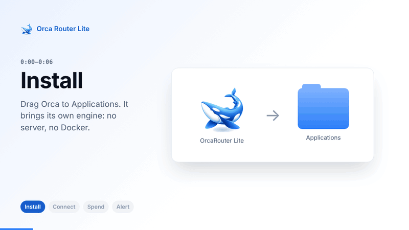

# Demo: 30-second storyboard



`demo.gif` is recorded from the real setup and panel pages of an engine filled with
demo data (`desktop/scripts/seed_demo.py`, the same seeder the screenshots use):

```bash
scripts/record_demo.sh                 # writes docs/launch/demo.gif
OUT=/tmp/demo.gif scripts/record_demo.sh
```

It needs `pip install -e .`, node with `playwright` and its Chromium, and ffmpeg. It runs in a
throwaway `HOME`, so your own `~/.orcarouter-lite` and agent settings are never touched.

| Time | Scene | On screen | Caption |
|---|---|---|---|
| 0:00–0:06 | **Install** | The app icon slides onto the Applications folder. | Drag Orca to Applications. It brings its own engine: no server, no Docker. |
| 0:06–0:14 | **Connect** | First-run setup: "Coding agents on this computer" with Claude Code, Codex, Gemini CLI and OpenCode found and ticked. | Setup finds the coding agents on this computer and connects them in one click. |
| 0:14–0:22 | **Spend** | Menu bar shows **$4.05**; the panel splits it: Claude Code $2.60, Codex $0.85, other apps $0.60, against a $20.00 budget. | Today's total in the menu bar, split by agent. |
| 0:22–0:30 | **Alert** | Same spend against a $5.00 budget: the bar turns amber and the notification "81% of today's $5.00 budget used" slides in. | A notification at 80% of the daily budget, and again at 100%. |

What's real and what's drawn: the setup page, the panel, every number and the notification's
wording are the app's own (`desktop/src-tauri/src/logic.rs`). The drag-to-Applications step, the
menu-bar strip and the notification card are drawn on the stage, because they belong to the OS rather
than to the app's pages. All amounts are demo data.

## Recording the real thing (optional, for a video)

For a screen recording of the installed app instead of the page-based GIF:

1. A clean macOS user account, the signed `.dmg` from the release, a 1440×900 display.
2. Before recording: `export ORCA_HOME=/tmp/orca-demo/.orcarouter-lite`, start the app once, then
   `python desktop/scripts/seed_demo.py` for the demo spend.
3. Record each scene for its slot above, with the captions as on-screen text. No voice-over needed.
4. Export at 30 fps, then make the GIF with the same `ffmpeg` palette step as `scripts/record_demo.sh`.
